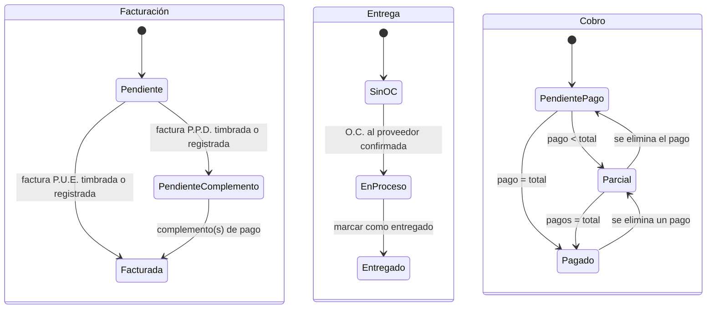

# Estados del proyecto: facturación, entrega y cobro

**Decided 2026-11-03, refined 2026-11-10 (see [Decisions 2026-11-10](#decisions-2026-11-10)); groundwork built
2026-11-10 (see [Built 2026-11-10](#built-2026-11-10-groundwork)).** Replaces the single post-O.C. line of stages
(`oc_recibida → facturado → en_entrega → cerrado`, `internal/store/projects.go`
`ProjectFlow`) with three independent states, as Emilio's issues ask: #63 (Facturas),
#66 (Estado de facturación y de entrega) and #67 (Estado de cobro). The questions still
open are posted on those issues; the transitions below are what the issues specify.

## Why the line doesn't fit

Today a proyecto moves one step at a time and the steps are gated: nothing is
`en_entrega` without a factura, and `cerrado` needs `pagado`. Payment is a side field
(`payment_status`: sin tramitar / facturado de anticipo / pagado), and P.U.E. means paid
at the moment of the factura. Cladex's real order of events varies: goods can be
delivered before the factura, payments arrive in parts, and the supplier O.C. drives
delivery. Emilio states it outright: *Entregado* and *Pendiente de facturar* is a valid
combination.

## The model (option B)

**Stage** stays a stored column, because people decide it:
`Prospecto → En curso (O.C. recibida) → Cerrado`, plus `Perdido`.

Once the client's O.C. is received, three states hang off the proyecto. **None is
stored**: each is derived from the records, so they can't disagree with them.

| State | Values | Derived from |
|---|---|---|
| Facturación | Pendiente → Pendiente complemento de pago (P.P.D.) → Facturada | the proyecto's comprobantes: a stamped (or manually recorded) factura, and for P.P.D. its stamped complemento(s) |
| Entrega | Sin emitir O.C. → En proceso de entrega → Entregado | the confirmed supplier O.C.s (#65) and a delivery record (#66) |
| Cobro | Pendiente de pago → Pago parcial → Pagado | `SUM` of a new payments table against the proyecto's total with IVA (#67) |

### Where the derivation lives: a view

SQLite generated columns can only read their own row, and these states read other
tables, so they live in a **view**, `project_states` (one row per proyecto: `facturacion`,
`entrega`, `cobro`). The list query joins it, and the existing per-column filters
(`projectFilterColumns`, plain SQL expressions) filter and sort on `ps.cobro` like any
column. One definition serves the list, the proyecto page, Pronóstico and the
Dashboard. At Cladex's scale (hundreds of proyectos) the subqueries are free, with the
foreign-key indexes in place.

If a list ever gets slow, the fallback is real columns with the same names kept by
triggers on the source tables (same transaction, indexable); nothing above the store
changes. Not worth the six-trigger surface until it's needed.

## Facturas: real stamping plus a manual mode

Decided: Facturoporti stamping (built 2026-10-20, see
[facturas-timbrado-y-envio.md §9](facturas-timbrado-y-envio.md#9-built-2026-10-20)) goes
live with real credentials. Alongside it, a **manual mode** per factura records one
issued outside the app (what exactly it stores is open question 4 on #63). Today's
typed-folio fallback is a site-wide switch for when facturación is off; manual becomes a
per-factura choice, and both kinds count the same for the Facturación state.

Método de pago (P.U.E./P.P.D.) moves from receiving the O.C. to the factura draft (#61).

## Procurement changes (#64, #65)

Supersedes decisions 1 and 4 in [ordenes-de-compra-a-proveedores.md](ordenes-de-compra-a-proveedores.md):
the default supplier is **per familia**, not per product, and there is **no exchange
rate** (an O.C.'s moneda is MXN or USD, printed in its conditions, nothing converted).

## Settled

- Option B: three derived states, stage reduced to Prospecto / En curso / Cerrado / Perdido.
- States in a `project_states` view; filters use it directly.
- Real stamping + per-factura manual mode.
- SAT codes are per SKU (#62, covering #54).
- Supplier per familia; no exchange rate.
- Deleting a proyecto stays a cascade (2026-11-05): it removes its supplier O.C.s,
  confirmed ones included, as the guide already says. No block for now. Only a
  stamped (or stamping) factura blocks the delete. Revisit if confirmed O.C.s start
  getting sent to suppliers from proyectos that later get deleted by mistake.
- Vendedores don't create suppliers inline from a QL O.C. (2026-11-05, "not yet"):
  a missing supplier goes through an admin on Proveedores.

## Open (asked 2026-11-03)

On #63: what cancelling or replacing a factura does to Facturación; whether P.P.D.
payments in parts each get a complemento (parcialidades, a contador question); whether
a P.U.E. factura records its payment automatically; what manual mode stores.

On #66: cancelling (not revising) a supplier O.C.; Entregado once or per O.C. on QL; a
deal that falls through after the O.C.; who may undo "O.C. recibida"; whether Cerrado is
automatic or a button once all three states are complete.

For Gerry: converting the proyectos already past `oc_recibida` in production
(`facturado`/`en_entrega` → En curso, `cerrado` stays, their typed factura and payment
carried into the new records). Count them before writing the migration.

## Decisions 2026-11-10

Emilio answered on 11-06 (#63, #66, #67). Gerry decided:

- **Cerrado is derived, not stored.** The `project_states` view adds `cerrado` (Facturada,
  Entregado and Pagado all hold). A correction that breaks one reopens the proyecto with no
  code. The stored stage becomes `prospecto / en_curso / perdido / cancelado`.
  "Cerrado · Ganado" is the label, filterable.
- **Cancelado** (new): admin only, with a motivo. It's blocked while there is a valid
  factura or an active supplier O.C. Reactivating it, also admin only with a motivo,
  restores the previous stage.
- **Undoing O.C. recibida:** admin only, with a motivo, only with no factura and no
  confirmed supplier O.C. The proyecto goes back to prospecto at Inminente 90%.
- **Entrega is per supplier O.C.**, shown as "1 de 2 entregadas". The comprobante can be
  added later, and an admin can undo Entregado. An admin can cancel a supplier O.C. with a
  motivo, but not once it's delivered; with no other active O.C., Entrega goes back to Sin
  emitir O.C.
- **Facturación:**
  - Parcialidades: several complementos per P.P.D. factura, each showing the saldo. What
    was built 2026-10-20 handles only one, so this extends it.
  - P.U.E. requires "ya se cobró" plus a date and records its payment.
  - Cancelling a factura puts Facturación back to Pendiente until the replacement exists.
  - Manual mode: XML required, PDF optional. It reads the UUID, date, total and RFC from
    the XML and warns on a mismatch; complementos work the same way.
- **Manual mode ships first and stays as the backup.** Real Facturoporti credentials are
  coming, but the app must keep working without the PAC.
- **Payments** (one table) link to their source: a P.U.E. factura, a complemento, or
  manual. A complemento offers to **link an existing unlinked manual payment** instead of
  creating a second one (double counting). Cancelling a factura **keeps** its payments;
  refunds are out of scope.
- **Asked Emilio (#63, 11-10):** how an anticipo paid before the factura is invoiced:
  P.P.D. for the total plus a complemento, or a factura de anticipo plus a nota de crédito
  (out of scope today).
- **Order:** after the [Dashboard](dashboard.md). Then groundwork (stage migration,
  payments, `project_states`, Cancelado, undo), #67 Cobro, #66 Entrega, #63 Facturas
  (manual), and real stamping last.

## Order (as of 2026-11-03)

1. #62 + #54 SAT codes per SKU, #64 Proveedores (in progress).
2. #65 supplier O.C.s (without cancellation until answered), #61 Recibir la O.C.
3. Once #63/#66 are answered: payments table, `project_states` view, stage migration,
   then #63's table and manual mode, #66, #67.

## Built 2026-11-10: groundwork

Migration `0041_project_states.sql` (exclusive, rebuilds `projects` and `project_files`):

- `projects.status` is `prospecto / en_curso / perdido / cancelado`; `oc_recibida`,
  `facturado`, `en_entrega` and `cerrado` became `en_curso`, and `lost_from = oc_recibida`
  became `en_curso`. New `cancel_reason`, `cancelled_from`, `cancelled_at`, in the audit
  triggers. The legacy `invoice_ref` / `invoice_date` / `payment_*` / `paid_at` columns stay.
- `project_files.kind` gains `pago` and `entrega` (the latter for #66, so it needs no
  rebuild).
- `payments` (project, amount in centavos with IVA, `paid_on`, `source`
  manual/factura/complemento, nullable `comprobante_id`, nullable `file_id` into
  `project_files`, created/deleted by/at, `delete_reason`), audited. Deleting is a soft
  delete: the row stays out of every sum and the motivo goes to the history (the codebase
  keeps its records append-only: `project_files`, `quote_comments`, `comprobante_events`).
  Every proyecto with `payment_status = pagado` got one manual payment for its current
  quote's total on its `paid_at`, recorded by whoever marked it pagado per the audit log
  (else its vendedor).
- `project_states` view: `facturacion`, `entrega`, `cobro`, `paid`, `last_paid_on`,
  `cerrado`, as described above. Every proyecto query joins it.

The flow is gone (`ProjectFlow`, `MoveProject`, the stage buttons and "Regresar a…").
Stamping moves no stage (M6.4 superseded), and the typed Factura form records the folio
without moving the stage. Admin actions with a required motivo, each a line in the
proyecto's history (`quote_comments`, as every stage change before): Cancelar proyecto,
Reactivar, Deshacer O.C. recibida.

Choices made beyond the issues (smallest sensible, recorded here):

- **Cerrado · Ganado can't happen yet.** `entregado` needs #66's delivery records, so the
  view never says it; the seam is the `entrega` CASE in the view. Proyectos that were
  `en_entrega` or `cerrado` before 0041 are en curso now (QA0037 in production: facturada
  by its typed folio, pagado by its migrated payment, Entrega from its supplier O.C.). #66
  can seed their deliveries from the audit log (their last status before 0041).
- **Cancelado from prospecto too**, not only en curso: the store and the admin panel allow
  both, and Reactivar goes back to whichever it was. **Perdido is prospecto only** now: a
  sale that falls through en curso is cancelled by an admin (Emilio, #66 answer 3).
- **Cancel blocks** on a factura that may be stamped (timbrada, timbrando, incierto,
  cancelación pendiente) or a confirmed supplier O.C.; a typed `invoice_ref` doesn't block
  it (nothing can cancel it). **Undo blocks** on those plus a typed `invoice_ref`; it
  clears `oc_number`/`oc_date` (they stay in the history comment and the audit log), keeps
  the O.C. files, and deletes unstamped factura drafts (they bill the order being undone,
  and drafts can't be deleted otherwise).
- **Correcting the client's O.C.** is allowed while en curso with Facturación pendiente
  (before: while `oc_recibida`, i.e. before the factura).
- **The Proyectos list** hides Cerrado · Ganado unless the Etapa filter asks for it or a
  search is typed (looking a proyecto up by folio finds it). Perdido and Cancelado stay in
  the default list, as Perdido did. The old Pago column is now Cobro (`ps.cobro`, en curso
  only).
- **Cobro with no payments is Pendiente** even for a quote whose total is $0.
- **A typed factura with a wrong folio can't be corrected** any more (before, an admin sent
  the proyecto back to O.C. recibida). The guide says to note the correction in a comment;
  #63's manual mode replaces the typed form.
