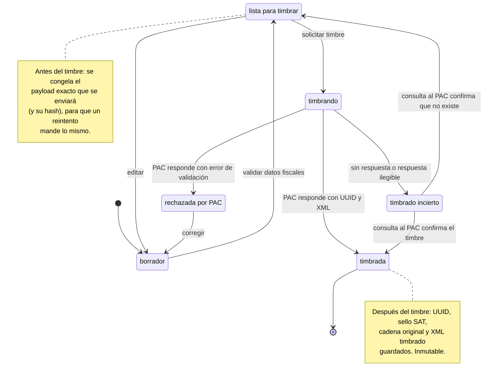
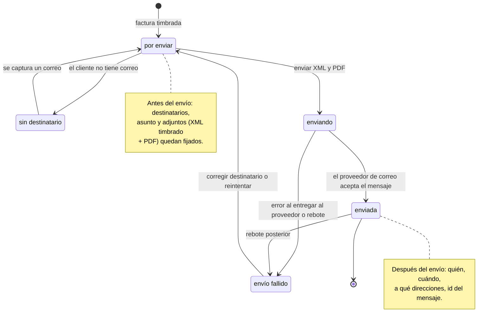
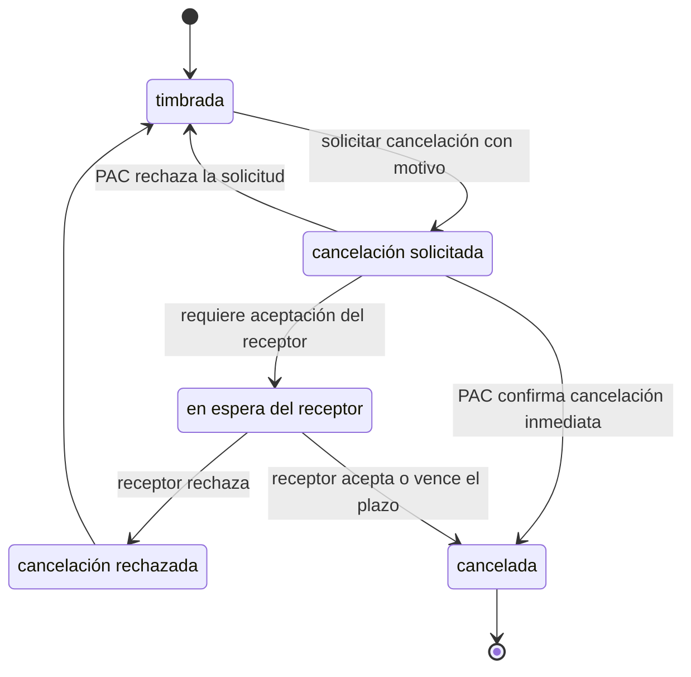

# Facturas: timbrado digital y envío

**Built (2026-10-20), against Facturoporti's sandbox; not yet stamping for real.** What
shipped and the decisions it took are in [§9](#9-built-2026-10-20); §1–§7 are the design it
follows, §8 the research.

This is the "facturas" item from [`docs/PLAN.md`'s backlog](../PLAN.md#backlog--deprioritized-not-scheduled),
and the invoicing half of the payment states in
[ciclo-de-vida-cotizacion-a-cobro.md](ciclo-de-vida-cotizacion-a-cobro.md). This doc is
scoped to what was asked for: tracking the moments **before and after getting the
timbre** from an external provider, and **before and after sending** the result to the
recipients. The provider is TBD, so everything below talks about a generic PAC
(Proveedor Autorizado de Certificación) and avoids any one vendor's API shape.

This doc deliberately does not specify SAT rules (cancellation motivos, deadlines,
required attachments, catalogs). Learning them and keeping up with changes is part of
the facturación work itself, driven by the chosen PAC's docs and the contador, not
decided here.

## Why timbrado needs its own states

Stamping is a call to a third party that **has legal side effects and can fail in an
ambiguous way**. Once the PAC has stamped, the invoice exists fiscally (it has a UUID
registered with the SAT) whether or not our app heard back. So the dangerous window is
"we sent the request and don't know the outcome". The states below exist to make that
window explicit and recoverable, instead of a `500` and a user clicking "Timbrar" twice.

## 1. Ciclo fiscal: de borrador a timbrada

- **`borrador`** — mutable, same idea as a quote draft. Built from a quote / OC.
- **`lista para timbrar`** — local validation passed: receptor fiscal data complete
  (RFC, name as registered with the SAT, `postal_code`, `tax_regime`, uso de CFDI),
  emisor certificate (CSD) valid, totals consistent with the frozen quote. The payload
  is frozen here. This is the **"before timbrado"** checkpoint.
- **`timbrando`** — a request is in flight. Persist the attempt row *before* the call
  (see §6), not after, so a crash mid-call leaves evidence.
- **`timbrado incierto`** — timeout, dropped connection, unparseable response. The
  rule: **never retry the stamp blindly from here.** First ask the PAC whether a stamp
  exists for that payload/identifier, then resolve to `timbrada` or back to
  `lista para timbrar`. Whether the chosen PAC offers a lookup by our own reference
  (or rejects duplicates) is a **selection criterion** for the TBD provider.
- **`rechazada por PAC`** — definitive validation error (bad RFC/régimen/CP
  combination, expired CSD, catalog mismatch). Keep the PAC's error text; user fixes
  and returns to `borrador`. No fiscal document exists.
- **`timbrada`** — the **"after timbrado"** state. Fiscally real and immutable. Any
  correction is a cancellation + replacement (§3), never an edit.

## 2. Envío al receptor

Starts when a factura becomes `timbrada`. Tracked as its own status, **separate from the
fiscal status**: a factura can be `timbrada` and still unsent, or sent and later
cancelled, and conflating them into one enum multiplies states.

- What exactly gets attached (XML, PDF) is a SAT/PAC matter, settled during the
  facturación work.
- "`enviada`" means the mail provider accepted the message, not that the client read it.
  Open/read tracking is out of scope unless asked for. A later bounce flips it to
  `envío fallido`, which is why that edge exists.
- Resends are normal (client lost the email): a resend is a new send event on an
  already-`enviada` factura, not a state change, so the history lists every send.

## 3. Cancelación

Only reachable from `timbrada`. Cancelling is also a call to the PAC/SAT and is not
necessarily instant: the diagram allows for a wait on the receptor, and the real rules
are to be established during the facturación work.

- A cancellation request carries a motivo, and correcting a stamped factura probably
  means replacement draft → stamp it → cancel the original. The UI should drive that
  sequence rather than expose raw cancellation.
- `cancelación rechazada` returns to `timbrada`: the invoice is still valid and the
  rejection stays in the history.
- Sending a cancellation notice to the receptor is a send event like §2 and should be
  tracked the same way.

## 4. Relación con el estado de pago

The payment board ([§3 of the other doc](ciclo-de-vida-cotizacion-a-cobro.md#3-estado-de-pago))
hangs off the factura:

| Method | Factura | Later |
|---|---|---|
| **P.U.E.** | factura `timbrada` + `enviada` | pago recibido → `pagado` |
| **P.P.D.** | *factura de anticipo* `timbrada` + `enviada` | payment completed → *comprobante de pago* (a second document with its own timbrado + envío), then `pagado` |

This follows the whiteboard's wording as drawn. Consequence: the §1–§2 machines must be
reusable for a **second document type** (the comprobante de pago), not hard-wired to
"factura de venta". Modeling a generic "comprobante" with a `tipo` costs little now and
avoids a rewrite.

## 5. Dependencies this exposes

- **Email**: the app has no outbound mail (`PLAN.md`: "no email dependency" was a
  deliberate auth decision). Sending facturas needs a provider (SMTP relay or
  transactional API), credentials in the NAS config, and a decision on the sender
  domain (`cladex.com.mx` SPF/DKIM). The 8 GB shared box argues for an external
  provider, not a local MTA.
- **PAC credentials and the CSD** (the emisor's certificate and private key) are
  secrets. The distroless/NAS setup needs a plan for storing them; the CSD key must not
  land in the DB or the repo in the clear.
- **Customer data gaps for CFDI 4.0**: `customers` has `rfc`, `postal_code`,
  `tax_regime` but not the **name exactly as registered with the SAT** (`name` is a
  free-form trade name today), nor a default **uso de CFDI**. Both are likely needed.
- **Emisor settings**: Cladex's own RFC, régimen, lugar de expedición, factura
  series/folio sequence (parallel to `folio_sequences` for quotes), CSD.
- **Network**: PAC calls are outbound from the NAS, which is fine behind NAT. Long
  term, timeouts and retries belong off the request path in a background job system
  (tracked separately). The **first milestone does not need one**: stamping and
  sending are triggered manually and retried by hand (the `timbrado incierto` and
  `envío fallido` states exist precisely so a person can see and redo them), which is
  enough to learn the PAC's behavior.

## 6. Tracking model (sketch)

The "before and after" requirement maps to an **append-only event log per
comprobante**, in the same spirit as `audit_log` and `quote_comments`, plus the current
status on the row for cheap listing:

| Event | Recorded when | Payload |
|---|---|---|
| `validated` | → `lista para timbrar` | frozen payload hash |
| `stamp_requested` | **before** the PAC call | attempt id, payload hash, provider |
| `stamp_succeeded` / `stamp_rejected` / `stamp_unknown` | **after** the call | UUID + raw response / error / timeout details |
| `stamp_reconciled` | resolving `incierto` | PAC lookup result |
| `send_prepared` | → `por enviar` | recipients, attachments |
| `send_attempted` / `send_accepted` / `send_failed` / `bounced` | around the mail call | provider message id / error |
| `cancel_requested` / `cancel_resolved` | around the cancel call | motivo, replacement UUID, outcome |

Raw PAC request/response bodies are kept (they are the evidence in a dispute), minus
anything secret. Like `quote_lines`, a `timbrada` factura's content is never rewritten.

## 7. Open questions

1. **Which PAC?** Drives the API shape, sandbox availability, pricing per stamp, whether
   it supports lookup-before-retry, and cancellation handling. Compare 2–3 on exactly
   the criteria in §1 and §3 before choosing.
2. **Does a factura always come from a quote/OC**, or can one be created standalone
   (anticipos, services, one-off sales)? Determines whether `facturado` in the project
   lifecycle is derived from a factura or is its own manual state.
3. **One factura per OC, or several** (partial deliveries, advance + final)? Affects the
   relation between `en entrega`, `facturado` and `pagado`.
4. **Who may stamp and cancel?** Ties into the sysadmin/admin/sales RBAC gap in the
   backlog; stamping is irreversible enough that it probably wants a narrower role than
   drafting.
5. **Send automatically on timbrado, or require a manual "Enviar"?** The whiteboard's
   "emisión de copias" note suggests copies to several people.
6. **Do we need delivery confirmation beyond "provider accepted"?**
7. **Retention**: where the stamped XML/PDF live (the NAS backup story covers files
   under the data dir).
8. **Test vs. real environment**: the PAC sandbox stamps are not valid. Prod
   currently holds mock quotes; the same separation must hold for facturas so a test
   stamp can never be confused with a real one.

## 8. Research: PAC and email (2026-10-19, for #20 and #18)

Desk research only; nothing has been signed up for or tested. Prices are from vendor
pages and third-party comparisons on that date and must be re-checked before deciding.

### Two kinds of PAC integration

- **"Classic" PAC** (Finkok, SW Sapien, and most others): the app builds the CFDI XML
  itself, computes the cadena original and the **sello with Cladex's CSD private key**,
  and sends the signed XML to be stamped. Cheapest per stamp (third-party comparisons
  put them around $0.15–0.45 MXN at volume), but the CFDI 4.0 XML, catalogs and signing
  are ours to build and keep current, and the CSD key has to live on the NAS.
- **API PAC / facturación API** (Facturapi, Fiscalapi, Facturama's API module, among
  others): the app sends JSON (receptor, conceptos, forma/método de pago) and the
  provider builds, signs and stamps the XML, renders a PDF, and handles cancellation. The
  **CSD is uploaded to the provider once**, so its key never sits on the NAS or in our
  DB. Higher price: a monthly fee plus a per-stamp charge.

At Cladex's volume (tens of facturas a month, not thousands), the per-stamp difference
is a few hundred pesos a year; the work and risk saved by an API PAC is far larger.

### What each criterion from §1 and §3 turned up

| | Facturapi | Fiscalapi | SW Sapien (classic) | Finkok (classic) |
|---|---|---|---|---|
| Price | $299 MXN/month + $0.60 per stamp, IVA included ([pricing](https://www.facturapi.io/pricing)) | $199 MXN/month base, stamps bought separately ([site](https://fiscalapi.com/)) | not published; ask sales | not published; ask sales |
| Sandbox | separate **Test key**; test invoices never reach the SAT; customers and products don't cross between Test and Live ([docs](https://docs.facturapi.io/en/api/)) | free test environment, no stamp limit | test host `services.test.sw.com.mx` | demo environment |
| Retry without double stamping (`timbrado incierto`) | `idempotency_key` on create invoice: "to avoid duplicates when retrying a request" | to confirm | **CustomID**: a repeated customId is refused as a duplicate stamp (error CFDI3307) | to confirm |
| Cancellation | API endpoint; the invoice carries cancellation status, motive and substitution UUID | yes | UUID / XML / PFX / CSD cancellation | yes |
| Sends the factura by email | **yes**: `POST /invoices/{id}/email` sends XML + PDF to the customer's address or a list | to confirm | an "email" header on stamping, up to 5 addresses | no |
| CSD key location | uploaded to Facturapi | uploaded to Fiscalapi | **on the NAS** (we sign) | **on the NAS** (we sign) |

### Recommendation for #20

**Facturapi**, for the first milestone:

- `idempotency_key` (we send the factura's own id) is exactly the "lookup by our own
  reference" §1 asks for. A timeout is resolved by retrying with the same key, never by
  a blind second stamp.
- Test and Live keys make the sandbox impossible to confuse with production (open
  question 8): the NAS config holds one key, and the app shows which one is active on
  `/ajustes`.
- No CSD key on the NAS. The only secret we keep is the API key, which goes in the NAS
  env/config like the other secrets, never in the DB.
- The cost is about $3,600 MXN a year plus $0.60 a factura.

Runner-up: **Fiscalapi** (cheaper monthly fee, similar model); check its idempotency and
email support first. Go classic (SW, for its CustomID) only if keeping the CSD with a
third party is unacceptable to the contador.

Before committing: try the 14-day free trial (Test mode needs no card), stamp and
cancel one test factura, and have the contador confirm Facturapi's PDF and that
uploading the CSD to a PAC is acceptable to them.

### Email (#18): what a provider gives us that we don't have

Sending mail is easy; **getting it delivered** is the hard part. From the NAS directly,
it would not arrive: a home or office connection's IP is on blocklists, has no reverse
DNS, and ports are often blocked. A provider brings:

- **Sending reputation**: warmed-up IPs that Gmail and Outlook trust.
- **Authentication handled**: DKIM signing with our domain's key and an SPF include, so
  mail "from cladex.com.mx" passes DMARC. Gmail and Yahoo reject unauthenticated mail
  from senders like us.
- **Bounces and complaints**: a webhook or log when an address doesn't exist or mail is
  marked spam, plus a suppression list so we stop retrying bad addresses. This is what
  feeds the `envío fallido` / `rebotado` states in §2.
- **Retries and queueing** for when the recipient's server is slow, and **logs** of
  every message with the provider's message id, which §6's event log stores.

What **we** need is modest: tens of messages a month, each with a PDF and XML attached,
from an address on cladex.com.mx, with a recorded outcome. That leaves three options:

1. **The PAC sends facturas** (Facturapi's email endpoint). Nothing else to set up for
   M7, but it reports only "ok", with no bounce tracking, so `rebotado` would not be
   detectable.
2. **Cladex's own mailbox over SMTP** (if the domain is on Google Workspace or
   Microsoft 365): free, and sent mail appears in a real Sent folder, but there are no
   bounce webhooks (bounces land in that inbox) and an app password to keep.
3. **A transactional provider**: **Postmark** (best known for transactional
   deliverability; 10K messages for $15 USD/month, a 100-message free tier) or **Resend**
   (3,000 messages a month free). Either has an API, webhooks and suppression lists.
   Amazon SES is cheapest at scale but needs more setup (warm-up, no DMARC reports), which
   isn't worth it at our volume.

**Recommendation:** M7 starts with **option 1** if Facturapi is chosen: it delivers the
factura, its outcome is "sent through the PAC", and #18 isn't on the critical path. Build
#18 as a general notifier on **Postmark or Resend** once a second kind of email exists
(follow-up reminders, copies), or once bounces need tracking. Either way we need to
know who manages **cladex.com.mx's DNS and mail**: SPF/DKIM records for any provider go
there.

### Decisions (Gerry, 2026-10-19)

- **PAC: Facturapi.** Next: open the account and try the 14-day trial in Test mode, stamp
  and cancel a test factura, and get the contador's OK on uploading the CSD to Facturapi
  and on its PDF. Signing up is Gerry's (an account with Cladex's fiscal data).
- **DNS and email: GoDaddy.** cladex.com.mx's DNS and mailboxes are at GoDaddy, so any
  SPF/DKIM records for a sending provider (#18) are added in GoDaddy's DNS panel. M7
  still starts with Facturapi sending the factura, which needs no DNS change.

### Change of PAC: Facturoporti (2026-10-19)

Emilio had already signed Cladex up with **Facturoporti**, so that replaces Facturapi. From
its API reference ([docs](https://developers.facturoporti.com.mx/reference/api-facturacion-electronica),
[index](https://developers.facturoporti.com.mx/llms.txt)); none of this has been tried yet:

- **Hosts**: sandbox `https://testapi.facturoporti.com.mx`, production
  `https://api.facturoporti.com.mx`. Auth is a bearer token created from the account's
  user and password. The environment is picked by host and credentials, so a factura row
  records which one stamped it, and `/ajustes` shows which one is configured.
- **Stamping from JSON** (`POST /servicios/timbrar/json`): we send datos generales,
  encabezado (with our `serie` and `folio`), conceptos; it builds the XML and returns
  `uuid`, `cfdixml` (the stamped XML), optionally `pdf` (base64) and `urlpdf`. The status
  code `000` means success.
- **The CSD travels with every request**: `csd` (certificate, base64), `llavePrivada`
  (key, base64) and `csdPassword` are fields of the stamping call; Facturoporti signs
  with them. Unlike Facturapi, **the CSD key lives on our side**: the files go on the NAS
  outside the DB and the repo (e.g. a read-only mount next to `data/`), the password and
  API credentials in the NAS env. Nothing secret is logged or stored in the event log.
- **PDF and email are built in**: `generaPDF`, and `enviaEmail` with `receptorEmail`, CC
  and BCC (semicolon-separated), subject and message; the response says `emailEnviado`.
  So M7 can send through the PAC, as planned for Facturapi, and #18 stays off the
  critical path.
- **Cancellation**: with CSD or PFX, single or multiple, plus the pending
  accept/reject requests the SAT routes to the receptor.
- **Status**: `POST /validar/estatuscfdi` asks the SAT for a CFDI's status, which needs
  its UUID.
- **Useful extra**: `POST /validar/rfc-sat` checks RFC, name, régimen and postal code
  against the SAT's list. That is a "Validar con el SAT" button on the customer's fiscal
  data from #17, and catches a bad receptor before a stamp is rejected.

**Gap: no idempotency key or lookup by our own folio** in the docs. After a timeout we
don't have the UUID, so the status query can't tell us whether the stamp happened. Until
Facturoporti answers otherwise, `timbrado incierto` is resolved by a person checking the
Facturoporti portal (their list of stamped documents, by serie and folio) before
retrying, which the design already allows (no blind retry). Questions for Facturoporti
support (soporte@facturoporti.com.mx):

1. If the same serie/folio is sent twice, is the second refused or does it return the
   first stamp? Is there an endpoint to look up a CFDI by serie/folio or by our own
   reference?
2. Does the sandbox take the SAT's test CSDs, and are sandbox stamps free?
3. Does our plan include API access, and how many stamps does it have
   (`GET /servicios/consultar/timbres` answers the second once we have a token)?

What we need from Cladex: the Facturoporti API user and password (or a separate API
user), and the CSD's `.cer`, `.key` and password, handed over outside chat and email, to
go on the NAS.

**Update (Gerry, 2026-10-19): Facturoporti already holds Cladex's CSD** (used for the
manual stamps done in its portal). That reshapes the secrets plan:

- **First question for support**: can `timbrar/json` stamp with the CSD stored on the
  account when `csd`, `llavePrivada` and `csdPassword` are left out? (Their docs call
  those fields "solamente si se va a sellar el documento".) If yes, the `.key` and its
  password never reach the NAS or travel in a request; the only secret we keep is the
  token. If no, they go on the NAS as described above.
- **Transport**: every call is HTTPS, so nothing crosses the internet in the clear; the
  app keeps Go's default certificate verification and never disables it.
- **Token**: `GET /token/crear` takes `Usuario` and `Password` **in the query string**,
  which servers tend to log, and returns a token that never expires. So the token is
  created once by hand (ideally for a separate API user), only the token goes in the
  NAS `.env`, the app never holds the account password, and a leaked token is revoked
  with `DELETE /token/borrar` and replaced.

### Facturoporti support answers (Emilio, 2026-10-20, #30)

Emilio asked support the questions above; their answers, and what each changes:

1. **The API does not use the CSD stored on the account.** Every `timbrar/json` call
   carries `csd`, `llavePrivada` and `csdPassword` in base64, added by the app. So the
   plan from before the "Update" stands: the `.cer` and `.key` go on the NAS outside the
   DB and repo (read-only mount), the password in the NAS env, and none of it is logged or
   kept in the event log.
2. **Resending the same serie and folio returns the first response, with the same
   stamp.** This settles `timbrado incierto` better than the portal check: retrying with
   the factura's frozen serie and folio is safe, since a second stamp can't happen. The
   retry stays a manual button (no job system), but nobody has to look anything up in the
   portal first. It requires that serie and folio are assigned once, when the factura
   becomes `lista para timbrar`, and never reassigned. To confirm in the sandbox: the
   repeated response carries the full XML, and how long Facturoporti remembers a folio.
   **There is no lookup by serie and folio.**
3. **Facturoporti keeps nothing stamped through the API**: the XML and PDF come back in
   the response and are lost if we drop them (their storage service costs extra). The
   app must store the XML in the same transaction that marks the factura `timbrada`. It
   is small text, so it goes in SQLite and is covered by Litestream and the backups; it
   is the legal document and has to be kept for the SAT's retention period. If the save
   fails after a successful stamp, the resend from (2) gets it back.
   **The PDF is not stored (Gerry, 2026-10-20):** it is a representation of the XML, so
   the app renders it on demand from the stored XML, deterministically, as quotes do: keep
   the source text, generate files as needed. Facturoporti's own PDF is at most a
   reference while building that template.
4. **The current plan is portal-only.** API stamps ("Timbres RestAPI") are bought
   separately, only when going to production: $1.45 MXN per stamp up to 30,000, packages
   from 100. Development and sandbox are free.
5. **A separate API user can be created**, or the stamps bought on the current user.
   Recommendation: a separate API user, so the token the NAS holds is not the portal
   login.
6. Support is sending the docs (token, stamping examples, Postman project) to Emilio's
   email, and offers a call with their developers; API support comes with the stamps.

Next for Cladex: forward that email to Gerry, create the API user, and hand over the CSD
(`.cer`, `.key`, password) privately when stamping in the sandbox works.

## 9. Built (2026-10-20)

Gerry asked for the whole feature against Facturoporti's API while real credentials are
pending. Code: `internal/facturoporti` (client, secrets, fake), `internal/facturacion`
(validation, request building, stamp/cancel orchestration, printed representation),
`internal/cfdi` (reading the stamped XML), `internal/store/comprobantes.go` and migration
0024, the `/facturas` screens. User guide: `docs/guia/facturas.md`.

Checked against the real sandbox (`FACTUROPORTI_SANDBOX=1 go test ./internal/facturoporti
./internal/facturacion`, public test user `PruebasTimbrado`): a factura with Cladex's
6-decimal unit prices, a P.P.D. factura and its Pagos 2.0 complement, a replacement
(relación 04) and a motivo 01 cancellation all pass the SAT's rules.

Decisions taken while building, beyond §1–§8:

- **`timbrado incierto` is resolved by resending the identical request**, not by a lookup:
  tested in the sandbox, Facturoporti answers a byte-identical request with the stamp it
  already made, while any change (even the `Fecha`) stamps anew. So the validated request
  is stored exactly (without the CSD, added at send time) and every retry sends those
  bytes. Re-validating re-dates the request and is only possible from `borrador`, which an
  `incierto` comprobante can't reach.
- **Facturoporti replaces the request's `Fecha`** with its own stamping time, so a stored
  request doesn't go stale.
- **Amounts are the quote's**: each concepto is a quote line (quantity, unit price to the
  micro, importe) and can't be edited on the factura; only descriptions and SAT codes can.
  IVA is computed per concepto and added up, as the CFDI states it, which can differ by a
  centavo from the quote's IVA on the subtotal.
- **One factura per proyecto** (open question 3), plus its replacements and one
  comprobante de pago for the whole total (no parcialidades yet).
- **SAT codes**: `c_ClaveUnidad` on units (MTR, KGM, H87 seeded), a default
  `c_ClaveProdServ` per familia (empty until the contador confirms them), both editable per
  concepto on the draft.
- **Sending** (§2) uses Facturoporti's `enviaEmail` at stamping time, to the addresses on the
  draft (the customer's email by default). There is no resend: that waits for #18.
- **The PDF is rendered from the stored XML** on demand (deterministic, with the SAT
  verification QR), never stored. Facturoporti's own PDF is not kept.
- **Proyecto gates (M6.4)**: stamping a factura moves the proyecto to Facturado in the same
  transaction (P.U.E.: pagado; P.P.D.: facturado de anticipo); stamping its pago leaves it
  pagado; a replacement updates the proyecto's factura reference. If the proyecto moved by
  hand meanwhile, the stamp is still recorded and the history says the proyecto wasn't
  moved. While facturación is off (no secrets), the typed folio forms stay.
- **Cancellation doesn't move the proyecto back**; an admin does that by hand if needed.
  The SAT won't cancel a factura with a stamped pago until the pago is cancelled.
- **Admin-only** actions; anyone signed in sees and downloads.
- **Environment guard**: each comprobante records whether it was validated for the
  sandbox; an instance won't stamp or cancel one made for the other host.

Not built: parcialidades, standalone facturas (without a proyecto), notas de crédito,
resending by email, a background job for retries.
