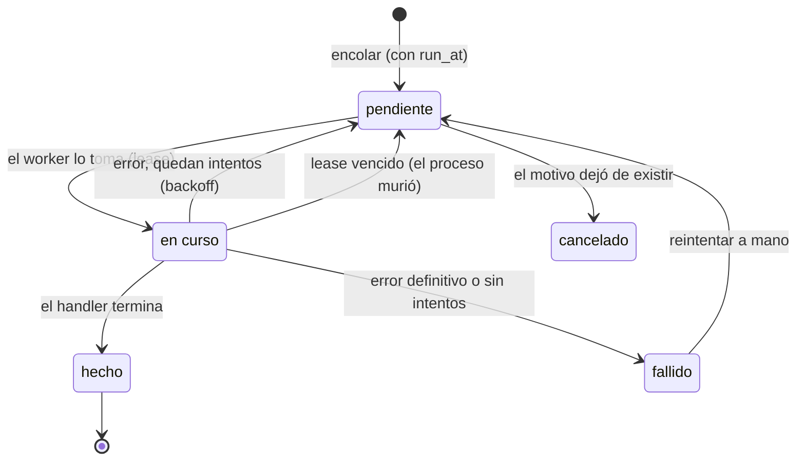
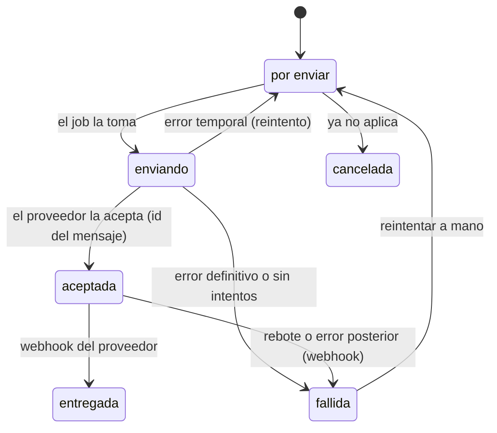
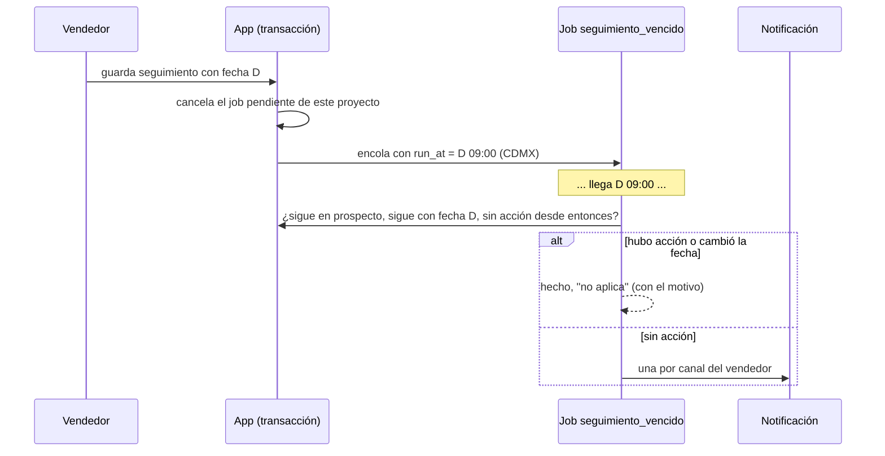

# Notificaciones y trabajos en segundo plano

**Proposed (2026-10-23), nothing built.** One design for
[#19](https://github.com/gerrygoo/cladex-web/issues/19) (background jobs) and
[#18](https://github.com/gerrygoo/cladex-web/issues/18) (outbound notifications), because
the second is the first real consumer of the first. A notification is a row written in the
same transaction as whatever caused it, and a job delivers it later, with retries.

Decisions so far (Gerry, 2026-10-23):

- **Channels: WhatsApp and email.** WhatsApp is mainly for the team (system users), but
  clients too. In-app is a separate dashboard, not a notification inbox.
- **Email through Resend and GoDaddy SMTP**, both supported from the start. Resend first;
  GoDaddy is set up with Emilio later (its own issue).
- **First consumer: the seguimiento reminder.** Emilio's description: each seguimiento
  creates an event that fires in the future if no action has been taken.

## 1. Trabajos (#19)

A small runner inside the existing binary, with its queue in SQLite. No new process, no
new container on the NAS.

**Storage.** `jobs`: `id`, `kind`, `payload` (JSON), `dedupe_key` (unique among live jobs
of a kind), `status`, `run_at`, `attempts`, `max_attempts`, `lease_until`, `last_error`,
`result` (short text: why a job did nothing, for the dashboard), `created_at`,
`finished_at`. No audit triggers (it's machine churn); what matters to people is recorded
by the handlers in their own tables.

**Runner.**

- One goroutine started by `runServer`, stopped by the same signal context. It wakes on a
  timer (30 s) and when a job is enqueued in-process, and runs one job at a time. At our
  volume, concurrency buys nothing, and SQLite has a single writer anyway.
- **Claiming** is one `UPDATE … SET status='en_curso', lease_until=now+5m … RETURNING`
  on the oldest due row. A lease that runs out (crash, SIGKILL) puts the job back to
  `pendiente`, so it survives restarts. A handler that needs longer than the lease is
  a bug.
- **Retry** with exponential backoff and jitter (1 m, 5 m, 30 m, 2 h, 12 h), 5 attempts by
  default. A handler can return a permanent error (bad address, rejected template) to
  skip straight to `fallido`.
- **Shutdown**: on SIGTERM the runner stops claiming, and the job in flight gets the 8 s
  the HTTP server already gets. Anything longer falls to the lease.
- **Pruning**: `hecho` and `cancelado` rows older than 90 days are deleted by a daily job
  of its own. Litestream and the backups cover the rest.

**Idempotency conventions.**

- A job runs **at least once**. Every handler is written so a second run is harmless:
  it re-reads the state it acts on and does nothing when the work is already done.
- Calls with side effects outside the app carry a key derived from the job's id, where
  the provider supports one (Resend's `Idempotency-Key`, to confirm). Where it doesn't
  (WhatsApp, SMTP), a duplicate can only happen if the process dies between the
  provider accepting the message and our commit. For notifications that's acceptable;
  nothing else in this design sends without a key.
- **Stamping stays manual.** Facturas are not moved onto jobs in this work: the manual
  retry with the frozen request (§9 of the facturas doc) already can't stamp twice, and
  nothing so far has shown a need to automate it.

**Scheduling.** A job with a future `run_at` is a timer that survives restarts. That's the
whole mechanism behind the seguimiento reminder (§3), so no separate cron is needed.

## 2. Notificaciones (#18)

### Model

A **notification** is one message, to one recipient, on one channel. The same reminder to
a vendedor by email and by WhatsApp is two notifications.

`notifications`: `id`, `kind` (`seguimiento_vencido`, …), `channel` (`email` /
`whatsapp`), the recipient (`user_id` or `customer_id`, plus the address or phone **as
it was** when queued), what it is about (`project_id`, `comprobante_id`, …), the rendered
content (subject and body for email; template name and parameters for WhatsApp), attachment
references (never the bytes: a factura's XML and PDF are rendered at send time, as
downloads are), `status`, `provider`, `provider_message_id`, `error`, `job_id`,
`created_at`, `sent_at`. Each attempt is appended to `notification_events`, in the
spirit of `comprobante_events`.

"Aceptada" isn't "read". WhatsApp reports `read`, and it's kept as an event, but nothing
depends on it.

### Channels

Each channel is a small Go interface, `Send(ctx, Message) (providerID string, err error)`,
with a fake for tests and local dev (it logs and records instead of sending).

| | Resend | GoDaddy SMTP | WhatsApp Cloud API |
|---|---|---|---|
| How | HTTPS `POST /emails`, bearer key | `net/smtp` + TLS: `smtpout.secureserver.net:465` (Titan) or `smtp.office365.com:587` (Microsoft 365), depending on the plan | HTTPS to Meta's Graph API, `/{phone-number-id}/messages`, bearer token |
| Content | subject + HTML/text, attachments | same | **only Meta-approved templates** outside the 24 h window after the recipient last wrote to us |
| Outcome | message id; webhooks for delivered/bounced/complained | accepted or not, nothing after; bounces land in the mailbox | message id; webhooks for sent/delivered/read/failed |
| Setup | account, domain verified with DNS records in GoDaddy | mailbox, SMTP auth enabled, app password | Meta Business account, a number not active on the WhatsApp app (or "coexistence"), templates submitted and approved |
| Cost | free up to 3,000/month | included in the mailbox; ~250–500/day limit | ~$0.0085 USD per utility template in Mexico from 2026-10-01 (third-party figures; check Meta's rate card) |

- **Email provider** is picked by config (`EMAIL_PROVIDER=resend|smtp`), and the same
  `notifications` rows work with either. Resend is recommended for anything to clients,
  since bounces are visible. Sending from a subdomain (`avisos.cladex.com.mx`) keeps any
  reputation problems away from the team's own mailboxes.
- **WhatsApp templates are part of the code.** Each kind maps to a template name,
  language and its parameters, and the template text is mirrored in the repo so a
  review shows what people will receive. A template Meta hasn't approved fails as
  `fallida` with Meta's error, and isn't retried.
- **Opt-in.** WhatsApp requires the recipient's consent. A user gives it by entering
  their number in the app. For a client, the customer record gets a "acepta WhatsApp"
  mark with its date, and the app won't send to a client without it.
- **Config and secrets** follow facturación: env on the NAS, never the DB. A channel
  without its secrets is off, not fatal, and `/ajustes` says which channels are on.
- **Staging can't reach clients.** Outside production, every notification goes to an
  allowlist of addresses and numbers (`NOTIFY_ALLOW`), and everything else is recorded
  as `cancelada` with that reason, the way the sandbox guard works for stamps.
- **Webhooks** (Resend's signed with Svix, WhatsApp's with the app secret) arrive at
  `/webhooks/resend` and `/webhooks/whatsapp`. The app is public behind the TLS proxy,
  so they reach it. Unsigned or unknown events are logged and ignored.

### Recipients

- `users` gains `email`, `whatsapp` (E.164, `+52…`), and the channels the user wants
  notifications on (email, WhatsApp, both). A user edits their own on a "Mis datos" page;
  an admin can edit anyone's, as with passwords.
- Clients use the customer's `email` and `phone` already on file, plus the WhatsApp
  opt-in.

### Dashboard

Admin-only, under Ajustes:

- **Notificaciones**: every notification, newest first, filterable by status, channel and
  kind; each shows its events and the provider's error, with **Reintentar** on a
  `fallida` and **Cancelar** on a `por enviar`. A "Enviar prueba" form sends a test
  message to yourself on each channel.
- **Trabajos**: pending, running and failed jobs, with the last error, `result` and
  **Reintentar ahora**.

The proyecto's own history gets a line when a notification about it is sent ("Aviso de
seguimiento enviado a Gerardo por WhatsApp"), so the vendedor's view needs no new page.

## 3. First consumer: el aviso de seguimiento

- **Scheduling.** `FollowUpProject`, in its own transaction, cancels the proyecto's
  pending `seguimiento_vencido` job and, when a new date is set, enqueues one for that
  day at 09:00 Mexico City time (`dedupe_key` `seguimiento:<project>:<D>`). Clearing the
  date only cancels. Losing the proyecto, or moving it out of `prospecto`, cancels too.
- **At run time** the handler re-checks everything (at-least-once, §1) and records in
  `result` why it did nothing when it does nothing.
- **What counts as "action"** (proposal, to confirm with Emilio): any new entry in the
  proyecto's history after the seguimiento was scheduled, such as a comment, a follow-up,
  a stage move or a revision. Setting a new date is itself an action, and replaces the
  reminder.
- **Who gets it**: the proyecto's vendedor (`projects.user_id`), on their channels.
- **Content**: folio, client, amount, the date that was set, the last history entry, and a
  link to the proyecto. In Spanish, in the app's tone.
- **Existing dates**: the migration enqueues reminders for proyectos whose next follow-up
  is today or later. Ones already overdue get none, so deploying doesn't send a burst; the
  board already flags those.

Questions for Emilio (they don't block the runner or the channels):

1. Is "any new history entry" the right meaning of "action"?
2. Only the vendedor, or the admins too? And if it's still ignored, a second reminder
   (e.g. 3 days later to the admins)?
3. 9:00 on the day, or a different hour?

## 4. Slices

| # | Slice | Done when |
|---|---|---|
| N1 | Runner (#19): `jobs`, worker, leases, backoff, pruning, Trabajos dashboard. | A job enqueued before a restart runs after it; a failing job retries on schedule and shows its error. |
| N2 | Notifications + email (#18): `notifications`, events, Resend and SMTP senders, fake, staging allowlist, user email/WhatsApp fields, Notificaciones dashboard with "Enviar prueba". | A test email from production arrives through Resend and its outcome is recorded; a send failure shows and can be retried. |
| N3 | Aviso de seguimiento by email. | A seguimiento with no action fires at 09:00 on its day; one with action, or a changed date, doesn't, and says why. |
| N4 | WhatsApp for the team: sender, templates, webhooks. | A vendedor with WhatsApp on gets the seguimiento reminder there, and its delivery shows in the dashboard. |
| N5 | Clients: factura resend and copies by email (the "no resend" gap in §9 of the facturas doc), WhatsApp with opt-in. Resend bounce webhook. | A stamped factura is resent to several recipients; a bad address shows as failed and can be fixed and resent. |
| N6 | GoDaddy SMTP in production (with Emilio, its own issue). | Switching `EMAIL_PROVIDER` to `smtp` sends the test email through Cladex's mailbox. |

N1–N3 need only a Resend account and its DNS records. N4 needs the WhatsApp setup
(Meta Business account, number, approved templates), which can start in parallel and
takes days because of Meta's reviews.

## 5. Not in this work

- Moving stamping onto jobs (see §1).
- A notification inbox or bell in the app.
- Free-text WhatsApp conversations and replies. Incoming messages are only logged.
- Email intake of RFPs (`PLAN.md` backlog). It would be a job, but it's its own feature.
