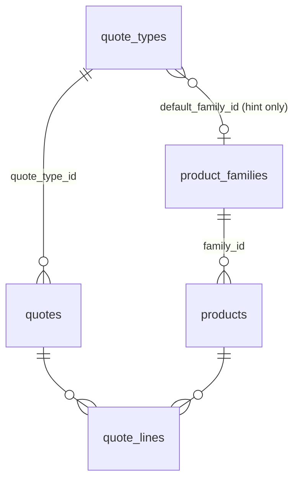

# Tipos de cotización: separating the quote series from the catalog familia

**Proposed (Gerry, 2026-10-28), nothing built yet.** Driven by
[#53](https://github.com/gerrygoo/cladex-web/issues/53): Emilio wants series prefixes longer
than two letters (`QCCA`, `QCCS`) and to rename the existing ones. Today that can't be done
safely, because the prefix text is used as a key.

## 1. The problem

Migration 0013 put the quote series on `product_families` (`series`, `series_label`,
`terms`, `free_lines_only`), one series per familia. Since then the prefix string has done
three jobs at once:

| Job | Where |
|---|---|
| **Label** printed in folios | `quotes.folio` = prefix + number |
| **Join key** (never a declared FK) | `quotes.prefix = product_families.series` to find a quote's terms, familia, free-lines flag, SAT code; `folio_sequences.prefix` is the counter's primary key |
| **Behavior switch** | `KgPricedSeries = "QG"`; `hidesAddress`: `QL`/`QI`; `ORDER BY (q.prefix = 'QI')`; `letterheadFor` and the CCS margin rule key on the familia *name* (`"CCA"`, `"CCS & AC"`, `"Alumoclad"`) |

Renaming `QA` would orphan every QA quote from its terms and familia, and renaming a
familia would silently change PDFs and pricing. The two concepts also don't line up: QL is
a "familia" with no products (it exists only as a series), and the product picker already
lets any product into any quote.

## 2. The model

Two independent concepts, each with an integer id as its only identity. No text is ever a key.

- **Tipo de cotización** (`quote_types`) is a kind of quote, meaning how it is numbered, built and
  printed. It has a prefix and its own counter, the PDF terms, the letterhead, and
  builder behavior. On "Nueva cotización" you pick one. In the UI, **Serie** stays as the
  name of its prefix field ("Tipo *Cable CCA*, serie `QCCA`"), the term Emilio already
  uses (and CFDI's *serie* + *folio*).
- **Familia** (`product_families`) is a catalog category: name, SAT product code, its
  products. It stays flat; any richer taxonomy is a later, separate decision this split
  keeps open.

They meet only in an optional hint: a familia's `default_quote_type_id` pre-selects the
type and the builder's product search defaults to the type's `default_family_id`. Neither
is relied on for identity or behavior.

### A quote's identity and folio

- `quotes.id` stays the primary key every FK uses.
- The folio's logical identity is **(`quote_type_id`, `folio_number`)**: a new integer
  column, `UNIQUE (quote_type_id, folio_number)`. Revisions keep sharing the base number
  with their `-R1` suffix, as today. That unique index therefore covers first quotes only
  (`supersedes_quote_id IS NULL`), while `UNIQUE (folio)` keeps covering all.
- `quotes.folio` (and `quotes.prefix`) become **snapshots** written once at creation and
  never re-rendered. The folio is in URLs, PDFs and customers' inboxes, so renaming a
  type's prefix never changes an existing folio: `QA0105` stays `QA0105`, and the next
  one is `QCCA0106`.
- The counter lives on the type (`quote_types.next_number`). Renaming continues the
  numbering by default; an admin can restart it, but only above the highest number
  already used by that type.

### Prefix rules (what the app enforces, so nobody has to think about keys)

- `Q` + 1 to 5 uppercase letters (`QA`, `QCCA`, `QCCSA`). This is open to change.
- **Unique across history**: rejected if it is any type's current prefix *or* appears in
  any `quotes.prefix` snapshot. Otherwise a new type reusing a retired `QA` would collide
  with the old `QA0001` on `UNIQUE (folio)` at its first quote. The message is plain:
  *"Esa serie ya se usó antes; elige otra."*
- Editable by an admin at any time; the change only affects folios handed out afterwards.

### Behavior becomes flags, never string comparisons

| Today | Becomes |
|---|---|
| `product_families.free_lines_only` | `quote_types.free_lines_only` |
| `hidesAddress`: prefix `QL`/`QI` | `quote_types.hide_address` |
| `letterheadFor`: familia name / QL, QI | `quote_types.letterhead` (`cladex`, `cladex_large`, `conduccasa`, `copperclad`, `alumoclad`) |
| `ORDER BY (q.prefix = 'QI')` | `quote_types.sort_last` |
| `KgPricedSeries = "QG"` | `quote_types.kg_priced` |
| CCS margin by familia name `"CCS & AC"` | `quote_types.copper_price_margin` |
| terms, `series_label` | `quote_types.terms`, `quote_types.name` |
| delivery time / currency | unchanged: already driven by tokens in the terms |
| SAT product code | stays on `product_families` (it classifies merchandise) |

Each flag is set by the migration to reproduce today's behavior exactly, then becomes an
admin-editable checkbox on the type's page.

## 3. CFDI counters

`comprobantes` folios also live in `folio_sequences`, under `"cfdi:" + serie` keys. That
is a second namespace sharing a table keyed by text. After quote counters move onto
`quote_types`, `folio_sequences` holds only CFDI series; the migration renames it
`cfdi_folio_sequences` with the `cfdi:` prefix stripped. CFDI series are fiscal
(registered in the PAC), so they stay text-keyed and are **not** made editable here.

## 4. Migration (one file, rehearsed on a copy of production first)

1. Create `quote_types` (with ids of its own) from every `product_families` row with a
   series, carrying prefix, label, terms, free-lines flag, and
   `next_number` from `folio_sequences`; set the behavior flags per §2's table;
   `default_family_id` = the familia, unless it is free-lines-only (QL).
2. Rebuild `quotes` (foreign keys off, as 0013/0016 did): add `quote_type_id NOT NULL
   REFERENCES quote_types (id)` backfilled through the prefix join (the last time that
   join runs), and `folio_number` parsed from the base folio; recreate indexes and audit
   triggers with the new columns.
3. Drop `series`, `series_label`, `terms`, `free_lines_only` from `product_families`;
   add `default_quote_type_id`.
4. Move CFDI counters to `cfdi_folio_sequences`; drop `folio_sequences`.
5. Verify in the migration: every quote has a type, `foreign_key_check` is clean, and
   each type's `next_number` is above its highest `folio_number`.

## 5. Slices

1. **T1, schema + reads.** Migration; store reads join on `quote_type_id`; every
   prefix or name comparison replaced by its flag. Behavior is unchanged, which pins with tests that
   render a PDF and price a draft for each existing type before and after.
2. **T2, admin page.** "Tipos de cotización" under Catálogos: create, edit name, prefix
   (§2 rules), terms, flags. Familias lose their series fields. `docs/guia/` updated
   (administración, cotizaciones, glosario: *tipo de cotización*, *serie*).
3. **T3, #53 proper.** Emilio renames `QA`→`QCCA` etc. from that page; nothing to build
   beyond T2, just verify with him.

## 6. Open questions

- **Max prefix length** (proposed 5 letters after the Q).
- **Restart numbering on rename?** Proposed: continue by default.
- Does Emilio want the type's **name** (*Cable CCA*) shown anywhere besides the
  new-quote picker and the quote page?
