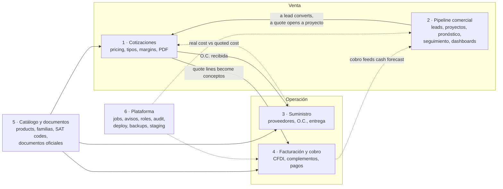

# Product tracks

**Started 2026-11-25.** A product-level map of Cladex: the tracks the app has grown
along, where each one could grow next, and the seams between them. The point is to
size work before it is designed, with a rough forecast of what it needs to do
(functional) and what it needs to withstand (non-functional), so we can choose between
edges instead of building whatever came in last.

How this relates to the other docs:

| Doc | Altitude | Tense |
|---|---|---|
| `docs/product/` (this) | Tracks and growth edges, sized roughly | What could come next, and why |
| `docs/planning/` | One feature's design: states, schema, slices, questions for Emilio | What we decided to build |
| `docs/PLAN.md` | Slices as built, the stack, settled decisions | What was built |
| `docs/guia/` | The user guide | What the app does, for its users |

An edge here graduates to a `docs/planning/` doc (or straight to an issue) once someone
decides to pursue it. Then the edge's row links to that doc and stops being edited here,
so the sizing stays a record of the forecast and can be checked against what happened.

## The tracks

| # | Track | Doc | Where it stands (2026-11-25) |
|---|---|---|---|
| 1 | Cotizaciones | [cotizaciones.md](cotizaciones.md) | Mature. The original product; most commits; in daily use |
| 2 | Pipeline comercial | [pipeline-comercial.md](pipeline-comercial.md) | Young and the fastest-moving: proyectos, pronóstico, avisos, dashboards and leads all date from Oct–Nov |
| 3 | Suministro | [suministro.md](suministro.md) | First version built (supplier O.C., entrega); barely used yet (1 O.C. in production) |
| 4 | Facturación y cobro | [facturacion-y-cobro.md](facturacion-y-cobro.md) | Built; production stamping on since 2026-11-14, but no proyecto has needed a factura yet (0 comprobantes) |
| 5 | Catálogo y documentos | [catalogo-y-documentos.md](catalogo-y-documentos.md) | Stable; grows by one-off bulk loads (Exceline, Astro) |
| 6 | Plataforma | [plataforma.md](plataforma.md) | Solid ops (blue/green, Litestream, staging); roles and WhatsApp are the long-open gaps |
| ↔ | Between tracks | [entre-tracks.md](entre-tracks.md) | The seams: where the larger product bets are |

The measured baseline every forecast starts from is in [baseline.md](baseline.md).

## Sizing: effort and lead time are separate numbers

The history shows that **building is rarely what makes us slow; waiting is**. Leads,
margins per tipo and price lists (#82, three slices) were designed and built on
2026-11-18. Dashboard (#72, #70) and the three derived project states were built on
2026-11-10. Meanwhile production stamping, code-complete on 2026-10-20, waited three and
a half weeks for credentials and the CSD (on 2026-11-14), WhatsApp has waited on Meta's verification since mid-November (#84), and finer roles
have sat in the backlog since 2026-08-12. So every edge gets **two** estimates:

**Effort**, in sessions of building (design, code, tests, guide and staging seed included):

| Size | Effort | Looks like | Example from history |
|---|---|---|---|
| XS | < 1 session | An issue fix, a field, a label | #89 delete a revision, #86 delete a retired margin |
| S | 1 session | One slice: one migration, one screen | L1 margins per tipo (0047) |
| M | 2–4 sessions | A feature: a few slices, a design doc | Leads + price lists (L1–L3); Dashboard (#72 + #70) |
| L | 5–10 sessions | A milestone: new subsystem, a design round with Emilio | Facturación against the sandbox; jobs + notifications (N1–N3) |
| XL | > 10 sessions, or open-ended | Changes the product's shape | RFP ingestion; inventory |

**Lead time**: what the calendar adds, and who controls it:

| Lead | Meaning |
|---|---|
| Internal | Only our build time. Emilio usually answers design questions the same day |
| Decision | Needs a product call from Gerry or a business call from Emilio, beyond a quick answer |
| Expert | Needs the contador, the SAT rules, a supplier's data |
| External | A third party with its own queue: Meta, the PAC, a bank, DNS/GoDaddy |

**Confidence** (low / med / high) says how much the size could move. Low means the
edge is not yet understood well enough to slice.

## How to write up an edge

Each track doc has the same sections: what the track is, its as-built state, the
signals (issues, data, commits) that say where it is pulling, then a table of growth
edges. Each edge answers:

- **Trigger**: what would make this worth doing now. An edge without a trigger is a
  "nice to have", and should say so.
- **Functional**: the few sentences a user would recognize: what they can now do.
- **Non-functional**: only the ones that change something: data volume, latency,
  correctness or legal requirements, idempotency with external systems, privacy and
  roles, backup/restore, migration risk to issued snapshots.
- **Size**: effort / lead / confidence, as above.
- **Depends on**: other edges, tracks or outside parties.

Checklist for the non-functional pass, distilled from what has bitten or shaped past
work:

1. **Snapshots.** Does it touch anything an issued quote, list, O.C. or factura has
   frozen? Issued documents never change (the CCS margin migration, tipos de cotización).
2. **Derived or stored?** We default to deriving state from records (project states
   view, seguimiento periods from the audit log). Does this break that, and at what
   volume would it need a cache?
3. **External side effects.** Anything sent to a PAC, an email or WhatsApp provider, or a
   bank needs an idempotency story and a sandbox/production guard (the stamping design).
4. **Roles.** Who may do it today, given only `admin` and `vendedor` exist?
5. **Files.** Does it store uploads? They are blobs in SQLite today, and they are 90%
   of the database (see [baseline](baseline.md#storage)).
6. **Deploy.** Does its migration need `-- cladex:exclusive` (a pause in blue/green)?
7. **Staging.** Does `seed-staging` need to produce this kind of record?
8. **Guide.** Which `docs/guia/` page changes?

## Picking the next edge

No ranking is stored here: it goes stale. When choosing, read the edges with a met
trigger across all tracks, compare effort against lead time, and prefer starting
External-lead edges early (their waiting overlaps other work), as was done with
facturación research (M5) running beside proyectos (M4).
