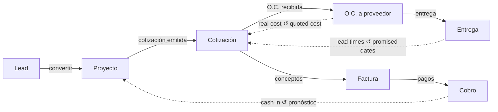

# Between tracks

The tracks were built one after another, each closing a gap Emilio named. The larger
opportunities sit where two tracks meet: data one track produces that another could use
but doesn't yet. Each seam below says which edges in the track docs it ties together.

The solid arrows are built. The dotted ones are the seams.

## The money loop

**Cotizaciones ↔ Suministro ↔ Facturación.** The app knows the quoted cost and margin,
the price, what the O.C.s actually cost (S1) and what the client actually paid (cobro).
Nothing puts them side by side today.

- **First step**: real margin per proyecto (S1), then per month on Equipo.
- **Then**: feed it back into quoting: "the last five QA proyectos came in 3 points
  under their quoted margin", and C3's stale-price warning.
- **Why it matters**: margins are the business's main lever and the reason M3 existed;
  this turns them from an input into a measured outcome.
- **Size**: S–M to see it (S1 + a total); M more to feed it back. Internal. Wants a
  dozen proyectos through operación before the numbers mean anything.

## The cash forecast

**Pipeline comercial ↔ Facturación y cobro.** Pronóstico says what might be sold and
when (with V2's expected dates); cuentas por cobrar (F2) say what's invoiced and when
it's due. Together they're a 90-day cash-in forecast.

- **Functional**: one admin view: expected collections by week from invoiced facturas,
  plus weighted pipeline by expected close month.
- **Non-functional**: entirely derived; the hard part is honest inputs (expected
  close dates, payment terms), which are decisions for Emilio, not code.
- **Size**: M after V2 and F2. Decision-led.
- **Why it matters**: it's the step from "a sales tool" to "how the business runs";
  probably the most valuable report the app could produce for its owner.

## One customer, one set of contacts

**Pipeline ↔ Cotizaciones ↔ Facturación ↔ Plataforma.** Leads carry their own contact
fields; customers have one contact; factura recipients are typed per draft; client
notifications (N5) will need opt-in per person. Contacts as records (V4) unify them,
and the customer view (V3) shows the whole relationship.

- **Size**: M (V4) + S–M (V3). Decision on what a contact is and who sees it.
- **Do before**: client WhatsApp (N5) and any lead capture from outside (V6), both of
  which create contacts.

## Sending documents

**Every track produces a PDF someone emails by hand**: quotes, price lists, supplier
O.C.s, facturas, fichas técnicas. One "Enviar" capability (P3) with attachments,
recipients from contacts, history on the record and bounces, then:

| Use | Edge | Size once P3 exists |
|---|---|---|
| Quote to client | C1 | XS–S |
| Price list to lead | (L3 follow-up) | XS |
| O.C. to supplier | S2 | XS–S |
| Factura resend | F4 | S |
| Ficha técnica with quote | K4 | XS |

P3 itself is M. This is the best ratio of value to effort across tracks: one piece of
plumbing removes five manual steps.

## Events and avisos

Every track emits events that someone should hear about: seguimiento overdue (built),
factura draft ready (E), cobranza (G), late supplier delivery (S4), approval pending
(C2), a job failed (P6). The aviso machinery (rounds, per-user toggles, escalation) is
general already. The seam is a shared vocabulary of events, so a new aviso is a row
and a template, not a feature. Keep each new aviso XS–S by holding to that.

## The audit log as the analytics layer

Seguimiento periods, Mis pendientes and Equipo are derived from the audit log, and so
would be win/loss (V1), forecast accuracy (V2), cost history (K2) and stage durations.
That decision (no second copy that can disagree) has served well. Its growth edge is
volume: at ×5 the audit log reaches ~110k rows a year, and replays on page load will
need a cache table kept by the same code (see [baseline](baseline.md#thresholds-to-watch)).
Plan for the cache when the threshold trips, not before.
